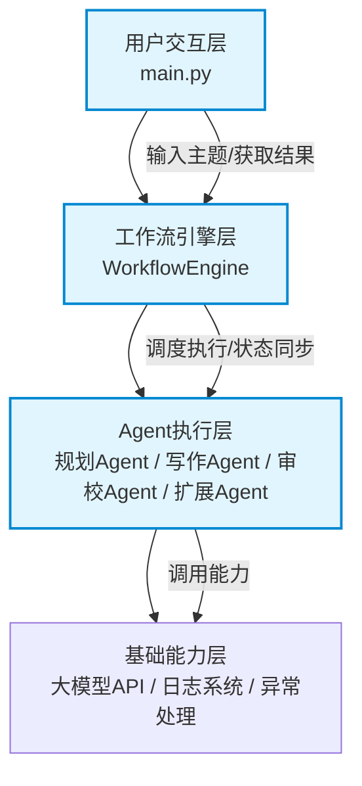
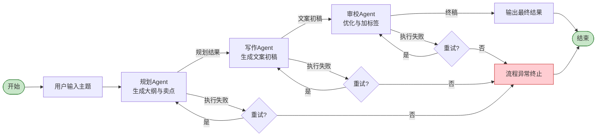

# 多Agent协作工作流系统设计文档

| 文档版本 | V1.0 |
| --- | --- |
| 项目名称 | 多Agent协作小红书种草文案生成工作流 |
| 适用课程 | 软件项目工程与项目实践 |
| 文档日期 | 2026-10-20 |

## 1. 设计目标

本项目为课程实践项目，核心目标是通过实现一个完整的多Agent协作工作流，深入理解并掌握以下核心概念：

1. 工作流（Workflow）的编排原理与流程控制逻辑
2. 多Agent之间的通信机制与消息传递方式
3. 全流程的状态管理与执行追踪方案
4. 可扩展的Agent架构设计方法

项目落地于贴近生活的内容创作场景，以小红书种草文案自动生成为业务载体，实现「主题输入→内容规划→正文写作→内容审校→终稿输出」的端到端自动化流程，兼顾技术学习价值与实际应用价值。

## 2. 设计原则

本系统在设计过程中遵循以下软件工程原则，保障架构的合理性与可维护性：

1. **单一职责原则**：每个Agent仅负责一项明确的业务职责，职责边界清晰
2. **面向抽象原则**：基于BaseAgent基类编程，上层引擎依赖抽象接口而非具体实现
3. **低耦合高内聚**：Agent间仅通过共享上下文传递数据，无直接依赖，便于独立修改
4. **容错性原则**：内置异常捕获与重试机制，避免单点故障导致整体流程崩溃
5. **可扩展原则**：新增业务节点无需修改核心引擎，保障架构的灵活性

## 3. 整体架构

系统采用分层架构设计，各层职责清晰，耦合度低，便于扩展与维护。

### 各层职责说明

1. **用户交互层**：负责接收用户输入、启动工作流、展示最终结果与执行日志，是系统与用户的交互入口。
2. **工作流引擎层**：系统核心，负责Agent的调度编排、流程顺序控制、全局状态管理、异常处理与日志记录。
3. **Agent执行层**：业务逻辑的执行者，每个Agent负责单一职责的任务，通过共享上下文接收输入、产出结果。
4. **基础能力层**：提供底层通用能力，包括大语言模型调用、日志持久化、错误重试等通用功能。

## 4. 工作流执行流程

系统核心为顺序执行的流水线工作流，完整覆盖正常执行链路与异常处理链路：

## 5. Agent 详细设计

所有Agent均继承自 `BaseAgent` 基类，遵循统一的接口规范，每个Agent专注单一职责，符合单一职责原则。

### 5.1 规划 Agent（PlannerAgent）

- **职责**：接收用户主题，完成内容前期策划，明确目标人群、核心卖点与文案结构
- **输入**：全局上下文中的 `user_topic`（用户输入的主题）
- **输出**：写入全局上下文的 `plan_result`（完整规划方案），更新 `current_step` 状态

### 5.2 写作 Agent（WriterAgent）

- **职责**：基于规划方案，生成符合小红书风格的种草文案初稿
- **输入**：全局上下文中的 `user_topic`、`plan_result`
- **输出**：写入全局上下文的 `draft_content`（文案初稿），更新 `current_step` 状态

### 5.3 审校 Agent（ReviewerAgent）

- **职责**：优化文案表达、修正错误、补充话题标签，输出最终可用文案
- **输入**：全局上下文中的 `user_topic`、`draft_content`
- **输出**：写入全局上下文的 `final_content`（最终文案），更新 `current_step` 与整体 `status`

### 5.4 扩展示例：标题优化 Agent（TitleOptimizerAgent）

- **作用**：验证架构可扩展性的示例Agent，用于生成多版本爆款标题
- **输入**：全局上下文中的 `user_topic`、`draft_content`
- **输出**：写入全局上下文的 `optimized_titles`（多版本标题），更新 `current_step` 状态
- **说明**：无需修改引擎核心代码，仅新增文件并加入执行列表即可生效，充分体现架构灵活性

## 6. 工作流引擎核心设计

### 6.1 流程控制原理

工作流引擎采用**顺序执行模型**，核心逻辑如下：

1. 接收按顺序排列的Agent列表作为工作流节点
2. 按照列表索引依次执行每个Agent的 `run` 方法
3. 单节点执行完成后，自动进入下一个节点
4. 任意节点执行失败且超过重试次数后，流程立即终止并返回错误信息
5. 所有节点执行成功后，标记流程为完成状态

该设计实现了基础的顺序流程控制，同时支持通过修改Agent列表灵活调整流程节点与顺序。

### 6.2 状态管理方案

系统通过**全局上下文字典（context）**实现全流程状态管理，所有状态数据集中存储，可追溯、可扩展。上下文伴随工作流启动而初始化，伴随流程结束而终止，全程在Agent间传递。

核心状态字段如下：

| 字段名 | 类型 | 说明 |
| --- | --- | --- |
| `status` | string | 工作流整体状态，取值：running / completed / failed |
| `current_step` | string | 当前执行步骤名称 |
| `step_durations` | dict | 每一步的执行耗时，键为步骤名，值为秒数 |
| `total_duration` | float | 流程总耗时，单位秒 |
| `error_msg` | string | 异常错误信息，仅流程失败时存在 |
| `user_topic` | string | 用户输入的初始主题 |
| `plan_result` | string | 规划Agent的输出结果 |
| `draft_content` | string | 写作Agent的输出结果 |
| `final_content` | string | 审校Agent的输出终稿 |

### 6.3 Agent 通信机制

Agent间采用**基于共享上下文的隐式通信**机制，技术选型上选择该方案的原因是：实现简单、链路清晰，非常适合线性流水线式的工作流场景，无需引入额外中间件。

完整通信流程：

1. 工作流启动时初始化全局上下文对象
2. 所有Agent共享同一个 `context` 字典对象引用
3. 上游Agent执行完成后，将自身产出写入上下文对应字段
4. 下游Agent执行时，直接从上下文中读取上游的产出作为自身输入
5. 流程结束后，上下文保留全链路所有阶段的产出与状态

## 7. 可扩展性设计

系统采用面向对象的抽象设计，具备良好的可扩展性，支持灵活的流程调整与能力扩展。

### 7.1 新增 Agent

新增业务Agent无需修改工作流引擎核心代码，仅需三步：

1. 在 `workflow/agents/` 目录下新建Agent文件
2. 继承 `BaseAgent` 基类，实现 `run` 方法
3. 在入口文件的 `agent_list` 中加入该Agent实例

### 7.2 修改工作流

调整工作流的节点顺序、增减节点，仅需修改入口处的 `agent_list` 列表：

- 调整顺序：改变列表中Agent的排列顺序
- 删除节点：从列表中移除对应Agent实例
- 插入节点：在列表指定位置加入新的Agent实例

### 7.3 能力扩展

工作流引擎的核心能力（重试次数、日志格式、状态字段等）均可通过修改引擎配置灵活调整，无需改动业务Agent代码。

## 8. 错误处理与容错机制

### 8.1 自动重试机制

- 单Agent执行失败后，自动进行重试，默认最大重试次数为1次
- 重试前自动等待1秒，避免API请求频率过高
- 重试过程完整记录到日志中，便于排查问题

### 8.2 异常捕获与优雅终止

- 全流程包裹异常捕获，任意节点出错均不会导致程序直接崩溃
- 异常发生后，自动记录错误信息到全局上下文与日志
- 标记流程为失败状态，清晰返回错误原因，便于定位问题
- 支持输入参数校验，缺少必要字段时提前抛出明确异常

### 8.3 日志追溯

- 全流程每一步操作均记录带时间戳的执行日志
- 日志同时输出到控制台与本地文件
- 日志文件按执行时间命名，支持历史执行记录回溯，便于调试与问题排查

## 9. 验证方法

### 9.1 流程完整性验证

- 输入合法主题，观察工作流是否按顺序执行全部三个核心Agent
- 验证最终输出是否包含完整的种草文案，确认端到端链路跑通

### 9.2 协作与状态验证

- 查看控制台日志，确认每一步均能正确读取上一步的输出
- 检查最终上下文字段，确认所有中间状态与最终结果均正确留存

### 9.3 容错能力验证

- 故意配置错误的API密钥，验证系统是否触发重试、是否优雅终止并输出错误信息
- 验证异常场景下日志是否完整记录，便于问题排查

### 9.4 可扩展性验证

- 将标题优化Agent加入执行列表，验证是否无需修改引擎即可正常执行
- 调整Agent执行顺序，验证流程是否按新顺序运行

## 10. 项目亮点总结

| 评审维度 | 对应实现亮点 |
| --- | --- |
| 流程完整性 | 三Agent流水线端到端跑通，覆盖正常与异常全链路 |
| Agent协作 | 基于共享上下文的通信机制，全链路状态可追溯 |
| 可扩展性 | 面向抽象的基类设计，新增Agent零侵入核心引擎 |
| 工程完备性 | 内置错误重试、日志持久化、输入校验，具备基础工程质量 |